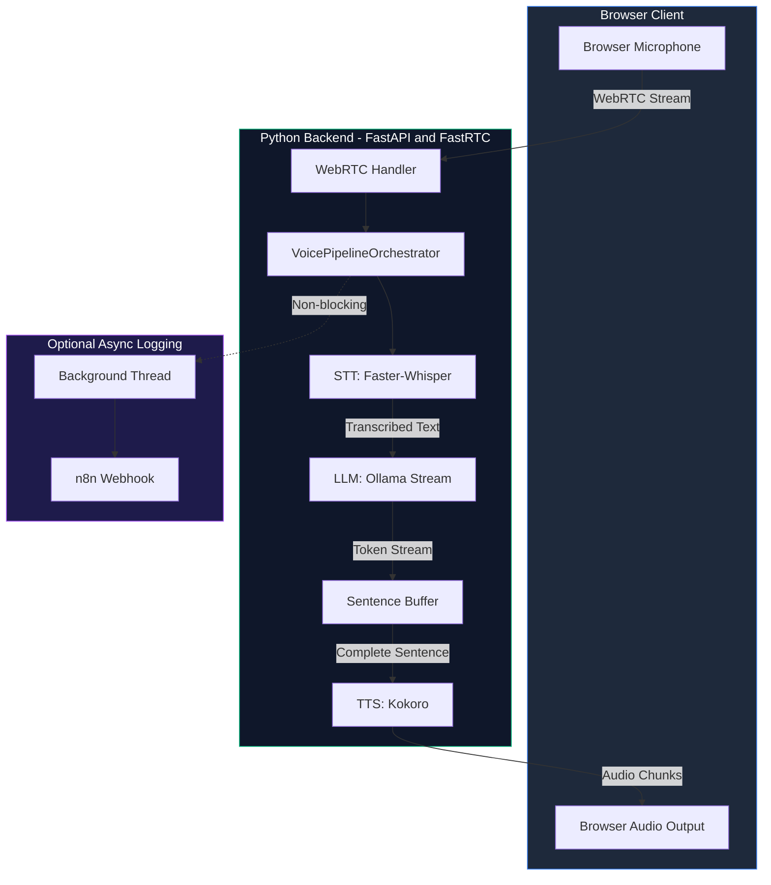

<div align="center">

# 🎙️ Local Real-Time Voice Agent

**A privacy-focused, local-first, real-time AI voice assistant powered by Python, WebRTC, Faster-Whisper, Ollama, and Kokoro TTS.**

[](https://www.python.org/)
[](https://fastapi.tiangolo.com/)
[](https://github.com/freddyaboulton/fastrtc)
[](https://ollama.com/)

</div>

---

Build an AI voice assistant that listens, understands, thinks, and speaks—**entirely on your local machine**.

Audio is captured directly through your browser microphone via WebRTC, transcribed locally with **Faster-Whisper**, processed by a local **Ollama** model, and synthesized into natural speech with **Kokoro TTS**. Using incremental sentence-level streaming, you hear the response as soon as the first sentence is generated, with full support for mid-sentence voice interruption.

## ✨ Key Features

- **Real-Time WebRTC Audio:** Low-latency microphone capture and audio playback directly in the browser via FastRTC.
- **Local Speech-to-Text:** Fast, accurate on-device transcription powered by Faster-Whisper.
- **Local LLM Inference:** Run any open-weights model locally through Ollama (`llama3.2`, `qwen2.5`, `mistral`, etc.).
- **Natural Voice Synthesis:** High-quality, low-latency text-to-speech using Kokoro TTS.
- **Sentence-Level Streaming:** Streams audio chunk-by-chunk as sentences complete—no waiting for full LLM generation.
- **Barge-In Interruption:** Speak over the assistant at any time to immediately cancel playback and start a new turn.
- **Optional n8n Logging:** Asynchronously dispatch conversation transcripts to an n8n webhook without blocking audio latency.

---

## 🏗️ System Architecture



### Pipeline Stages

| Stage | Component | Responsibility |
| :--- | :--- | :--- |
| **1. Capture** | Browser / FastRTC | Streams microphone audio over WebRTC and detects speech pauses. |
| **2. Preprocess** | NumPy / Audio Utils | Converts stereo to mono, normalizes `int16` to `float32`, and resamples to `16 kHz`. |
| **3. Transcribe** | Faster-Whisper | Converts the prepared audio segment into text locally. |
| **4. Generate** | Ollama | Streams response tokens from your local language model. |
| **5. Stream TTS** | Kokoro TTS | Splits tokens into complete sentences and synthesizes audio immediately. |
| **6. Log (Optional)** | `n8n_client.py` | Sends user prompt and assistant response to n8n in a background thread. |

---

## 📁 Project Structure

```text
Voice-Agent-WebRTC-Service/
├── main.py                     # Application entry point
├── requirements.txt            # Python dependencies
├── README.md                   # Project documentation
├── config/
│   └── settings.py             # Model names, URLs, and runtime configuration
└── src/
    ├── server.py               # FastAPI app initialization, CORS, and /health endpoint
    ├── webrtc/
    │   └── handler.py          # FastRTC stream setup, interruption, and orchestration
    ├── pipeline/
    │   ├── stt.py              # Faster-Whisper transcription service
    │   ├── llm.py              # Ollama streaming and sentence boundary splitting
    │   └── tts.py              # Kokoro TTS audio synthesis
    └── automation/
        └── n8n_client.py       # Asynchronous webhook client
```

---

## 🚀 Getting Started

### 1. Prerequisites

- **Python 3.10+**
- **Git**
- **[Ollama](https://ollama.com/)** installed and running locally

Pull a local model via Ollama:

```bash
ollama pull llama3.2
```

### 2. Clone and Install

```bash
git clone [https://github.com/bibekpandey0521/Voice-Agent-WebRTC-Service.git](https://github.com/bibekpandey0521/Voice-Agent-WebRTC-Service.git)
cd Voice-Agent-WebRTC-Service

# Create and activate virtual environment
python -m venv .venv

# Windows (PowerShell)
.venv\Scripts\Activate.ps1

# Linux / macOS
source .venv/bin/activate

# Install dependencies
pip install --upgrade pip
pip install -r requirements.txt
```

> **GPU Acceleration:** For CUDA support with Faster-Whisper, ensure compatible NVIDIA drivers and CUDA/cuDNN libraries are installed for `ctranslate2`.

### 3. Configure Settings

Edit `config/settings.py` to match your local setup:

| Variable | Default | Description |
| :--- | :--- | :--- |
| `WHISPER_MODEL_SIZE` | `base.en` | Whisper model size (`tiny.en`, `base.en`, `small.en`, `medium.en`) |
| `OLLAMA_BASE_URL` | `http://localhost:11434` | Local Ollama server endpoint |
| `OLLAMA_MODEL` | `llama3.2` | Name of the pulled Ollama model |
| `N8N_WEBHOOK_URL` | `""` | Optional n8n webhook URL (leave empty to disable) |

### 4. Run the Voice Agent

**Launch the WebRTC Voice UI:**

```bash
python main.py
```

Open **`http://localhost:7860`** in your browser, allow microphone permissions, and start speaking.

**Or run via Uvicorn (FastAPI Backend):**

```bash
uvicorn main:app --host 0.0.0.0 --port 8000 --reload
```

Verify the server status at `GET http://localhost:8000/health`.

---

## ⚙️ Customization and Troubleshooting

<details>
<summary><b>Customization Map</b></summary>

| Goal | Target File | Function / Area |
| :--- | :--- | :--- |
| Change assistant system prompt | `src/pipeline/llm.py` | `generate_sentence_stream()` |
| Switch LLM or Whisper model | `config/settings.py` | Model configuration constants |
| Enable GPU / change compute type | `src/pipeline/stt.py` | `STTService.__init__()` |
| Change Kokoro voice profile | `src/pipeline/tts.py` | `stream_audio()` |
| Adjust pause / interruption timing | `src/webrtc/handler.py` | `ReplyOnPause(...)` |
| Customize n8n JSON payload | `src/automation/n8n_client.py` | `_send_webhook_sync()` |

</details>

<details>
<summary><b>Common Troubleshooting</b></summary>

- **Ollama Connection Error:** Ensure the Ollama desktop app or `ollama serve` is running on `http://localhost:11434`.
- **Model Not Found:** Run `ollama list` in your terminal to confirm the model name matches `OLLAMA_MODEL` in `config/settings.py`.
- **No Microphone Access:** Check browser site permissions. Note that browsers require `localhost` or `HTTPS` for WebRTC microphone access.
- **Slow First Response:** Use `tiny.en` or `base.en` for Whisper and a quantized 3B-8B model in Ollama if running on CPU.

</details>

---

## 🔒 Privacy and Security

- **100% Local Processing:** Audio capture, transcription, LLM generation, and speech synthesis run locally on your hardware.
- **External Webhooks Opt-In:** Conversation data only leaves your machine if `N8N_WEBHOOK_URL` is explicitly configured.
- **Production Hardening:** If exposing the FastAPI server over a network, enforce HTTPS, restrict CORS origins in `src/server.py`, and never commit `.env` files or API keys.

---

<div align="center">

**Built with Python, FastRTC, Faster-Whisper, Ollama, and Kokoro TTS.**

⭐ *If you find this project useful, consider giving the repository a star!*

</div>
